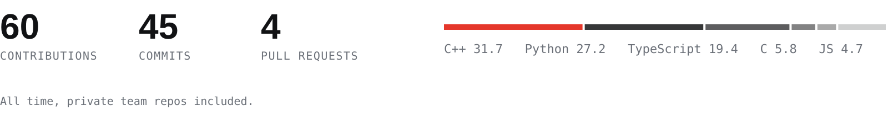

<!--
  Profile README — github.com/Hesyitena
  header/work: python gen.py · numbers: .github/stats.py (nightly workflow)
-->

<picture>
  <source media="(prefers-color-scheme: dark)" srcset="assets/header-dark.svg">
  
</picture>

Surabaya, Indonesia · [alaikas66@gmail.com](mailto:alaikas66@gmail.com) · [@Penship-Team](https://github.com/Penship-Team) &nbsp;

### About

Computer engineering student at PENS, in the programming division of **PENSHIP**, the PENS team that competes at
Kontes Kapal Indonesia and Teknofest. I write the software that lets the team's autonomous surface vehicle see and
steer (ROS 2, computer vision), and the web ground control station used to watch it run.

Outside the vehicle: an IoT monitoring system, the PENSHIP team website, GerakPulih, a Flutter app for at-home physiotherapy, and
[Shiftwheel](https://github.com/Hesyitena/shiftwheel), an offline Windows tool that converts files from a radial menu (Rust, Tauri).

### Work

<picture>
  <source media="(prefers-color-scheme: dark)" srcset="assets/work-dark.svg">
  
</picture>

### Activity

<picture>
  <source media="(prefers-color-scheme: dark)" srcset="assets/numbers-dark.svg">
  
</picture>

### Tech stack

<picture>
  <source media="(prefers-color-scheme: dark)" srcset="https://skillicons.dev/icons?i=ros%2Cpy%2Ccpp%2Cc%2Crust%2Cts%2Cjs%2Cdart%2Chtml%2Ccss%2Cmarkdown%2Creact%2Cnextjs%2Cvite%2Ctauri%2Cnodejs%2Ctailwind%2Csupabase%2Csqlite%2Cpytorch%2Canaconda%2Copencv%2Carduino%2Cdocker%2Cgithubactions%2Cvercel%2Cnetlify%2Cgit%2Cnpm%2Cpnpm%2Cvscode%2Cpowershell%2Clinux%2Cubuntu%2Cwindows&perline=12&theme=dark">
  
</picture>

### Public

- [`shiftwheel`](https://github.com/Hesyitena/shiftwheel) — offline Windows tray utility: drag a file, pick a slice on a radial wheel to convert, OCR or compress it. Rust + Tauri.
- [`ros2-smart-obstacle-avoidance`](https://github.com/Hesyitena/ros2-smart-obstacle-avoidance) — reactive explorer for TurtleBot3.
- [`rag-modul`](https://github.com/Hesyitena/rag-modul) — offline RAG chatbot for lecture PDFs, with page citations.
