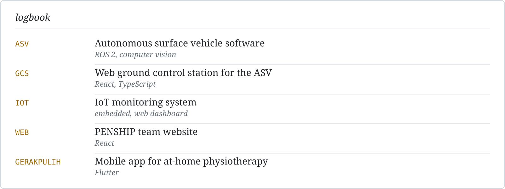
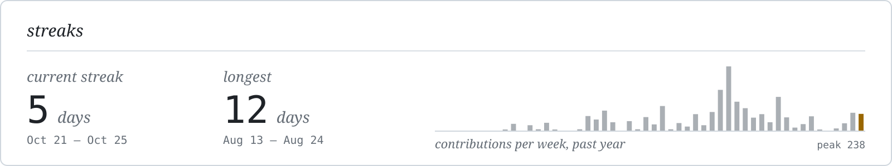
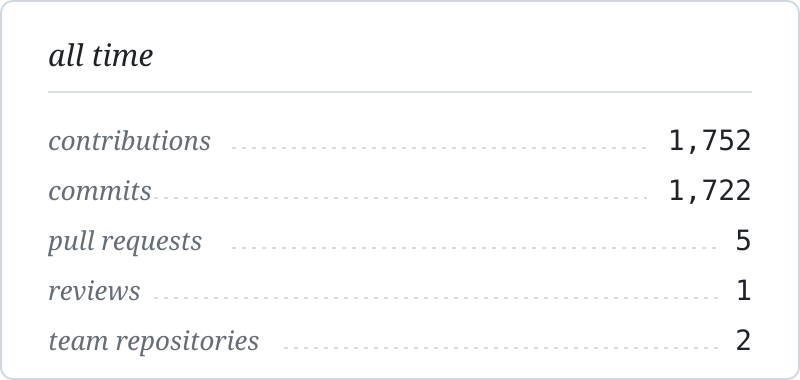
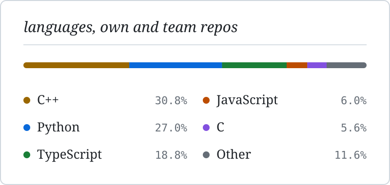

<!--
  Profile README — github.com/Hesyitena
  Folder assets/ harus ikut di-upload ke repo yang sama.
-->

<picture>
  <source media="(prefers-color-scheme: dark)" srcset="assets/banner-dark.svg">
  
</picture>

I write software for an autonomous surface vehicle with **PENSHIP** ([@PenshipTeam](https://github.com/PenshipTeam)), the PENS team that competes at
Kontes Kapal Indonesia and Teknofest. Most of that work lives in private team repos, so the
contribution graph says more than the repository list.

<picture>
  <source media="(prefers-color-scheme: dark)" srcset="assets/logbook-dark.svg">
  
</picture>

<picture>
  <source media="(prefers-color-scheme: dark)" srcset="assets/streak-dark.svg">
  
</picture>

  <picture>
    <source media="(prefers-color-scheme: dark)" srcset="assets/stats-dark.svg">
    
  </picture>
  <picture>
    <source media="(prefers-color-scheme: dark)" srcset="assets/langs-dark.svg">
    
  </picture>

### Public

- [`ros2-smart-obstacle-avoidance`](https://github.com/Hesyitena/ros2-smart-obstacle-avoidance) —
  reactive explorer for TurtleBot3 with adaptive cruise control and randomized turn decisions.

### Tools

<picture>
  <source media="(prefers-color-scheme: dark)" srcset="https://skillicons.dev/icons?i=ros%2Cpy%2Ccpp%2Cc%2Cts%2Cjs%2Cdart%2Chtml%2Ccss%2Cmarkdown%2Creact%2Cnextjs%2Cvite%2Cnodejs%2Ctailwind%2Csupabase%2Csqlite%2Cpytorch%2Canaconda%2Copencv%2Carduino%2Cdocker%2Cgithubactions%2Cvercel%2Cnetlify%2Cgit%2Cnpm%2Cpnpm%2Cvscode%2Cpowershell%2Clinux%2Cubuntu%2Cwindows&perline=11&theme=dark">
  
</picture>

alaikas66@gmail.com · Surabaya, UTC+7
