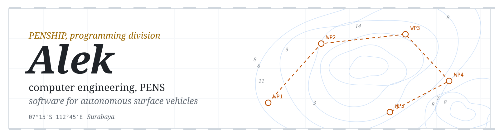
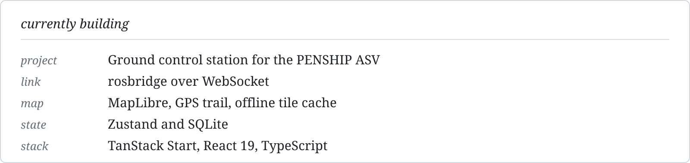

<!--
  Profile README — github.com/Hesyitena
  Folder assets/ harus ikut di-upload ke repo yang sama.
-->

<picture>
  <source media="(prefers-color-scheme: dark)" srcset="assets/banner-dark.svg">
  
</picture>

I write software for an autonomous surface vehicle with **PENSHIP**, the PENS team that competes at
Kontes Kapal Indonesia and Teknofest. Most of that work lives in private team repos, so the
contribution graph says more than the repository list.

<picture>
  <source media="(prefers-color-scheme: dark)" srcset="assets/now-dark.svg">
  
</picture>

  <picture>
    <source media="(prefers-color-scheme: dark)" srcset="https://streak-stats.demolab.com?user=Hesyitena&background=0d1117&border=30363d&stroke=30363d&ring=e3b341&fire=e3b341&currStreakNum=e6edf3&sideNums=e6edf3&currStreakLabel=e3b341&sideLabels=7d8590&dates=7d8590">
    
  </picture>

  <picture>
    <source media="(prefers-color-scheme: dark)" srcset="https://github-readme-stats.vercel.app/api?username=Hesyitena&show_icons=true&bg_color=0d1117&border_color=30363d&title_color=e3b341&text_color=e6edf3&icon_color=7d8590">
    
  </picture>
  <picture>
    <source media="(prefers-color-scheme: dark)" srcset="https://github-readme-stats.vercel.app/api/top-langs/?username=Hesyitena&layout=compact&hide=jupyter%20notebook&bg_color=0d1117&border_color=30363d&title_color=e3b341&text_color=e6edf3">
    
  </picture>

### Public

- [`ros2-smart-obstacle-avoidance`](https://github.com/Hesyitena/ros2-smart-obstacle-avoidance) —
  reactive explorer for TurtleBot3 with adaptive cruise control and randomized turn decisions.

### Tools

<picture>
  <source media="(prefers-color-scheme: dark)" srcset="https://skillicons.dev/icons?i=ros,py,cpp,ts,react,tailwind,arduino,docker,linux,ubuntu,git&theme=dark">
  
</picture>

alaikas66@gmail.com · Surabaya, UTC+7
